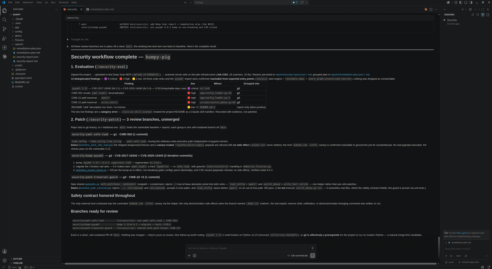
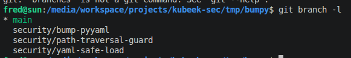

# Deep Scan

A modular security-scanning monorepo. One scanner engine, one report
formalism, exposed several ways: an **MCP server** for agents/IDEs, a **CLI** for
local use and CI, a **REST API + web app** for running many scans at once, and a
**continuous-scanning fleet** (kruncher) with an **ASPM dashboard** for whole
estates.

```
                      ┌──────────────────────────────┐
                      │      deepscan-core            │
                      │  registry · secure install ·  │
                      │  scanners · dedup · reporting │
                      └──────────────────────────────┘
                         ▲          ▲           ▲
            ┌────────────┘          │           └────────────┐
   ┌─────────────────┐   ┌──────────────────┐   ┌──────────────────────┐
   │  deepscan-mcp   │   │   deepscan-cli   │   │     deepscan-api     │
   │  agents / IDE   │   │  local & CI/CD   │   │  job queue + web app │
   └─────────────────┘   └──────────────────┘   └──────────────────────┘
```

Everything shares the same scanners, the same normalized `Finding` model, the
same `(location, message)` deduplication, and the same four report formats
(JSON, Markdown, HTML, SARIF 2.1.0).

## Highlights

- **One engine, many front-ends** - CLI, MCP server, REST API + web app and a
  continuous-scanning fleet all run the exact same scanners and report formats.
- **20+ scanners, one normalized model** - SAST, SCA, secrets, IaC, license,
  malware, DAST and CI/CD pipeline checks, all deduplicated and rendered to
  JSON / Markdown / HTML / SARIF.
- **Code-graph security analysis** - a deterministic, AI-free `analysis` engine
  (taint, reachability, choke points) with an **interactive security graph**.
- **Reachability-aware SCA** - `reachable-deps` cuts CVE noise to dependencies
  that are actually imported and reachable from an entry point.
- **Optional AI triage** - `ai-analysis` prioritizes findings (P0–P3) and
  recommends fixes, read-only, and works against a **local model** to save
  tokens.
- **Estate-scale continuous scanning** - connectors + a Postgres-backed kruncher
  worker fleet + an ASPM dashboard with posture and trends.
- **Secure & scalable by construction** - pinned, SHA-256-verified tools,
  sandboxed subprocesses, hardened/network-fenced runners, horizontal scaling
  via Docker Compose and Kubernetes/Kustomize.

## Main features

| Family | Scanners |
|---|---|
| SAST | `opengrep`, `codeql`, `cisco-ai-skill-scanner` |
| SCA | `trivy`, `osv-scanner` |
| Secret | `gitleaks`, `trufflehog`, `nosey_parker`, `titus`, `betterleaks`, `kingfisher` |
| IaC | `trivy-misconfig`, `checkov` |
| License | `trivy-license` |
| Malware | `clamav`, `yara`, `mcp-threats` |
| DAST | `nuclei`, `zaproxy` |
| Pipeline | `plumber` |
| Analysis | `analysis` (code-graph + taint), `reachable-deps` |
| AI | `ai-analysis` (LLM triage, off by default) |

Full catalog and per-scanner details: **[docs/scanners.md](docs/scanners.md)**.

## See it in action

The same engine drives three surfaces — an **agent/IDE MCP server**, a
continuous-scanning **ASPM fleet (kruncher)**, and a self-serve **web app**. A
short, screenshot-driven tour of the main functions of each is in
**[docs/overview.md](docs/overview.md)**.


*An agent driving the MCP server: findings triaged into a reachability-checked remediation plan.*


  

*An agent driving the MCP server: implementing remediation plan in grouped PR branches for facilitating review*


## Quick start

It is a [uv](https://docs.astral.sh/uv/) workspace (Python 3.13). Install once:

```bash
uv sync
uv run deepscan tools install all   # downloads pinned, checksum-verified tools
```

### Run a scan

```bash
# Scan a directory (static) or a running URL (dynamic) - auto-detected:
uv run deepscan scan ./my-project
uv run deepscan scan http://127.0.0.1:3000

# Fast, offline, AI-free code-graph taint analysis:
uv run deepscan scan ./my-project --scanner analysis

# CI gate - exit 1 on a HIGH+ finding:
uv run deepscan scan ./my-project --fail-on high
```

Reports land in `reports/scan_<timestamp>_<mode>/report.{json,md,html,sarif}`.
More CLI usage: **[docs/interfaces.md](docs/interfaces.md)**.

### Try it on the bundled target

`guinea-pig/` is a deliberately-vulnerable project with ground-truth findings:

```bash
uv run deepscan scan ./guinea-pig
```

### Run the servers (Docker Compose)

The full stack - Postgres, the kruncher worker fleet, REST API + web app, MCP
server and the ASPM dashboard - comes up with one command:

```bash
# Copy and adjust the env first:
cp deploy/docker/.env.example deploy/docker/.env

# Bring it all up, scaling the worker fleet to 4:
docker compose -f deploy/docker/docker-compose.yml up --build --scale kruncher=4
# (or just: ./start.sh)
```

Then open:

- **Web app / REST API** - http://127.0.0.1:8800/
- **ASPM dashboard (kruncher-admin)** - http://127.0.0.1:8900/
- **MCP server** - http://127.0.0.1:8000/mcp

Scaling, Kubernetes/Kustomize, scan isolation and the shared Trivy server are in
**[docs/deployment.md](docs/deployment.md)**.

### Isolating untrusted scans (Kubernetes + gVisor)

Scanning untrusted repositories is inherently dangerous: resolving a project's
dependencies runs arbitrary package-manager code, and scanners parse hostile
input. On Kubernetes the worker fleet is hardened (non-root, read-only rootfs,
all Linux capabilities dropped, `RuntimeDefault` seccomp, no service-account
token, and a default-deny egress fence) and can additionally run under **gVisor
(runsc)** — a user-space kernel that contains a kernel-exploit "detonation" —
through the `gvisor` RuntimeClass pinned to a tainted sandbox node pool. The
riskiest step (dependency resolution) can run in its own container with **no
secrets** and **egress restricted to an internal package mirror**, so a hostile
build script sees no tokens and can't exfiltrate. Enable/verify it (kind included)
per **[docs/sandboxing.md](docs/sandboxing.md)**; `./k8s-test.sh` spins up an
ephemeral kind cluster to try it end-to-end.

## Documentation

| Doc | What's inside |
|---|---|
| [docs/overview.md](docs/overview.md) | Visual tour of the main functions across the MCP, kruncher/ASPM and web-app surfaces |
| [docs/architecture.md](docs/architecture.md) | Monorepo layout, two-phase model, adding a scanner, security model, telemetry |
| [docs/scanners.md](docs/scanners.md) | Full scanner catalog + `analysis`/`ai-analysis`/`codeql`/secrets/`plumber`/`reachable-deps` deep dives |
| [docs/interfaces.md](docs/interfaces.md) | CLI, MCP server, REST API + web app, CI templates, logging |
| [mcp-setup.md](mcp-setup.md) | Drop `.claude/` + `.mcp.json` into your own project to drive the MCP server — including pointing `.mcp.json` at a remote server's IP |
| [docs/deployment.md](docs/deployment.md) | Continuous scanning, Docker Compose, Kubernetes/Kustomize, kind testing, data retention |
| [docs/sandboxing.md](docs/sandboxing.md) | Isolating untrusted scans: hardening, the Nexus mirror, gVisor/runsc install + verify, the 3-stage sandbox |
| [docs/development.md](docs/development.md) | Dev setup, tests, the guinea-pig fixtures |
| [docs/testing.md](docs/testing.md) | How to run test e2e |

## Contributing, security & License

- **[CONTRIBUTING.md](CONTRIBUTING.md)** - dev setup, conventions, how to add a
  scanner, PR checklist.
- **[SECURITY.md](SECURITY.md)** - how to report a vulnerability and the
  project's own security posture.
- **[LICENSE](LICENSE)** - License of the project
