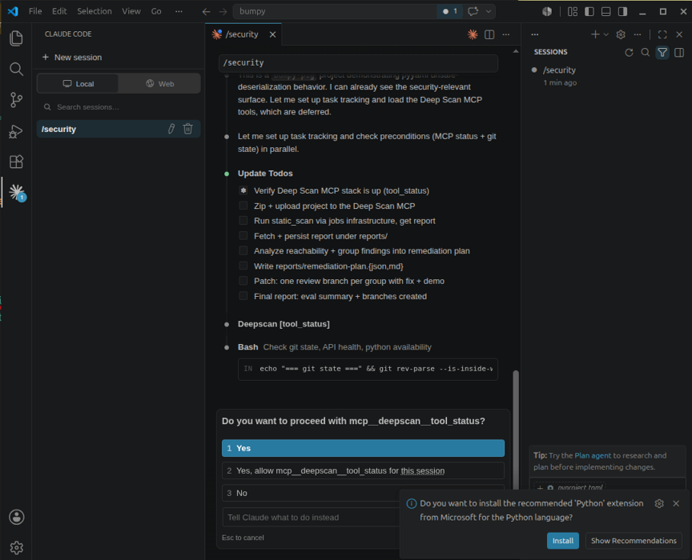
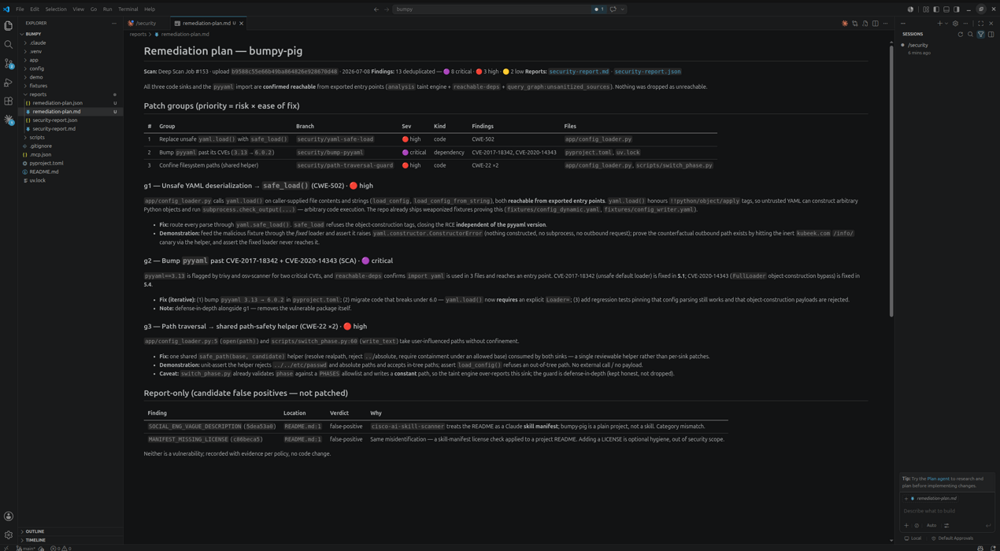
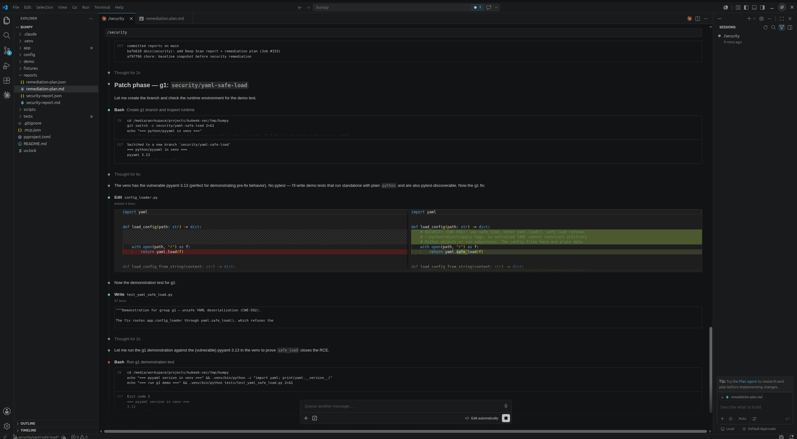
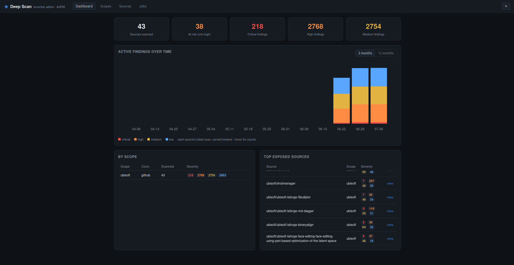
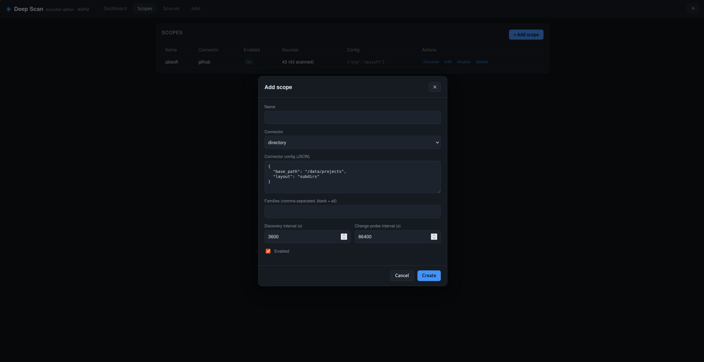
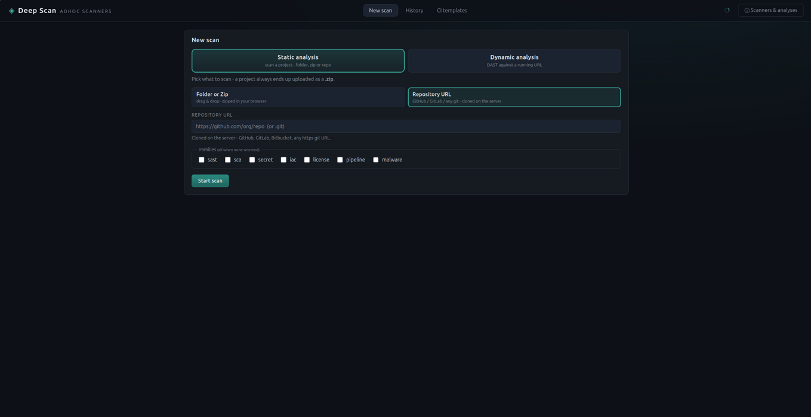
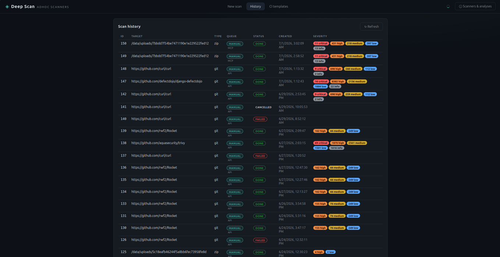
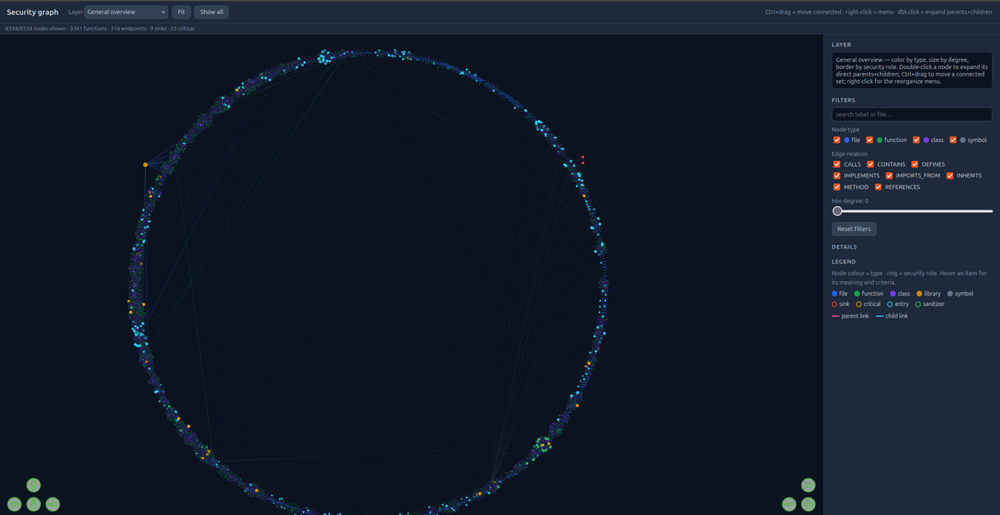
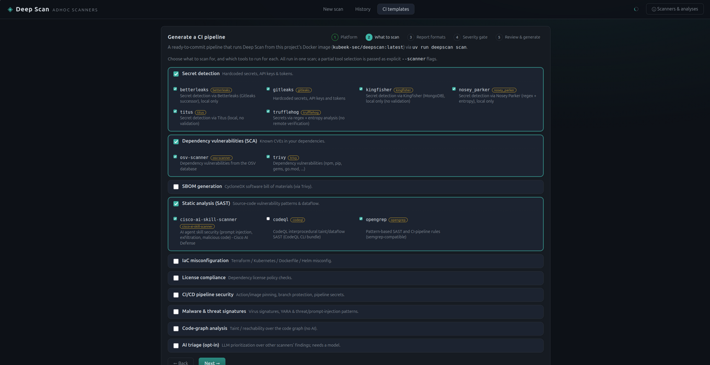
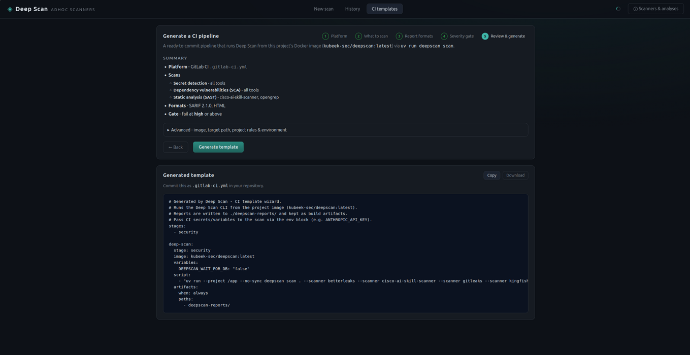

# Deep Scan — a visual tour

One engine ([`deepscan-core`](architecture.md)), the same normalized `Finding`
model and the same four report formats (JSON, Markdown, HTML, SARIF 2.1.0),
surfaced three ways. This page walks through the **main functions** of each
surface with screenshots; each section links to the reference docs.

| Surface | For whom | Main functions |
|---|---|---|
| [Agent & IDE (MCP)](#agent--ide--the-mcp-server) | agents, IDE assistants | scan a project, query the code graph for reachability, drive a full triage → remediation → patch loop |
| [Continuous scanning & ASPM (kruncher)](#continuous-scanning--aspm-kruncher) | security teams | scopes & connectors, change-driven scanning of a whole estate, posture dashboard, job control |
| [Self-serve web app](#self-serve-web-app--ad-hoc-scans--ci-templates) | developers | ad-hoc static/dynamic scans, scan history, generate a CI pipeline |

The [CLI](interfaces.md#cli) is the fourth surface and the one every pipeline
ultimately runs — it has no UI, so it isn't pictured here.

---

## Agent & IDE — the MCP server

The [MCP server](interfaces.md#mcp-server) exposes the scanners to agents and
IDEs as tools: `static_scan` / `dynamic_scan` / `scan_family` / `scan_with`,
`list_scanners` / `tool_status` / `install_tool`, and — to interrogate a
project's code graph — `list_graph_questions` and `query_graph`. Every scan
becomes a job in the shared Postgres store and (when deployed) is run by the
kruncher fleet, so agent-launched scans show up in the web app too.

An agent can drive the whole loop end to end: check the stack is up, upload the
project, run a scan through the jobs infrastructure, then fetch and persist the
report.

*An agent orchestrating the MCP tools: verify the stack (`tool_status`), upload, `static_scan` via the job queue, then analyze and patch.*

Because `analysis` (taint / reachability) and `reachable-deps` run alongside the
other scanners, and `query_graph` answers precise AppSec questions
(unsanitized sources, endpoint → sink paths, vulnerable-deps → critical), the
agent can separate *confirmed-reachable* findings from noise and group them into
a prioritized remediation plan (priority = risk × ease of fix).

*The remediation plan: each group carries CWE, severity, affected files, a concrete fix and a demonstration; candidate false positives are recorded, not patched.*

Finally the agent turns each group into a reviewable change — one branch per
group with the fix and a demonstration test that proves the issue is closed.

*One review branch per group: here `yaml.load()` → `yaml.safe_load()` (CWE-502), with a standalone demonstration test.*

**Learn more:** [MCP server & `query_graph`](interfaces.md#mcp-server) ·
[the `analysis` / `reachable-deps` engines](scanners.md) ·
[code-graph schema](graph)

---

## Continuous scanning & ASPM (kruncher)

For whole estates, **connectors** discover sources and the **kruncher** worker
fleet scans them change-driven, storing every result in Postgres. The
**kruncher-admin** ASPM dashboard turns that history into posture: how many
sources are scanned, how many are at risk, findings by severity, the trend over
time, a per-scope breakdown and the most exposed sources.

*ASPM dashboard: posture stat tiles, the active-findings trend (3 / 12 months), by-scope severity, and the top exposed sources.*

A **scope** binds a connector (`github`, `gitlab`, `git`, `directory`) to its
config and cadence — how often to discover new sources and how often to
change-probe them for rescans.

*Creating a scope: pick a connector, set its config and the discovery / change-probe intervals. The Jobs tab lets you follow and stop running jobs.*

**Learn more:** [continuous scanning, connectors & scaling](deployment.md) ·
[scan isolation](deployment.md#scan-isolation)

---

## Self-serve web app — ad-hoc scans & CI templates

The [REST API + web app](interfaces.md#rest-api--web-app) is a *submitter*: a
scan posted here becomes a job on the manual queue that the kruncher fleet runs,
so the API process is never saturated. The **New scan** tab launches an ad-hoc
scan — static (folder, zip upload or a git URL) or dynamic (a running URL), with
an optional per-family filter.

*New scan: choose static or dynamic, point at a folder/zip/repo, optionally narrow to specific families.*

The **History** tab lists every past scan — ad-hoc and MCP alike — paginated,
each tagged with its queue, status and a severity breakdown, with the full
report available in any of the four formats.

*History: every scan with its queue, status and severity breakdown; open the report as JSON / Markdown / HTML / SARIF.*

The **CI templates** tab is a five-step wizard that generates a ready-to-commit
pipeline for your platform (GitHub Actions, GitLab CI, Bitbucket, Azure
Pipelines, Jenkins, …). You choose what to scan and which tools per capability —
the catalog comes straight from the live scanner registry, so it never drifts
from what the CLI actually runs.

*Pick the capabilities and the exact tools per capability…*

*…review the summary, then copy or download the generated pipeline file.*

**Learn more:** [REST API endpoints & the CI-template generator](interfaces.md#rest-api--web-app) ·
[scanner catalog](scanners.md)

---

See the [documentation index](README.md) for the full reference.
